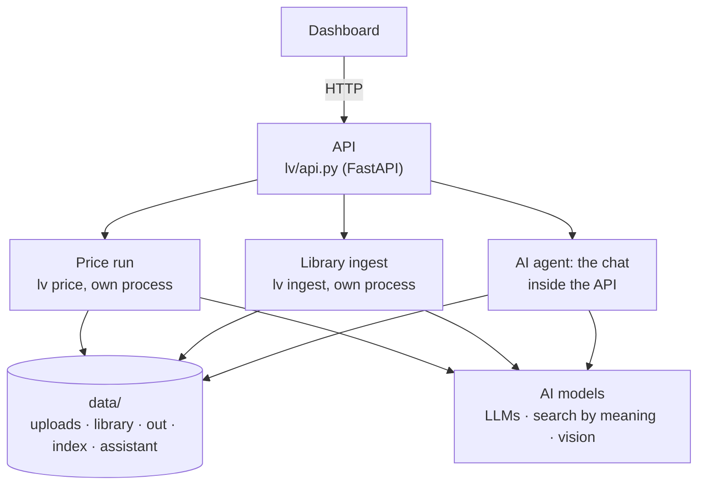
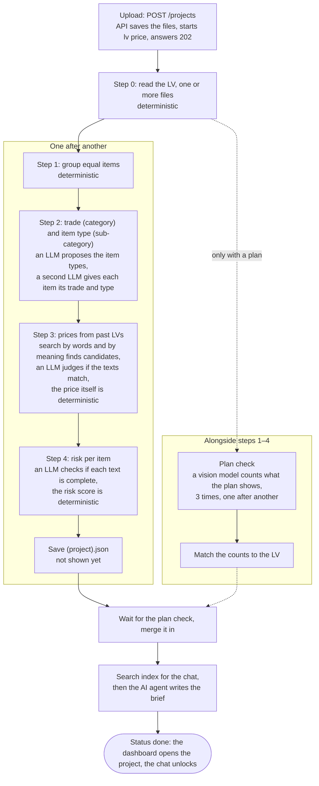

# bauindustrie_hack: Needle

Needle prices a new LV (Leistungsverzeichnis: the bill of quantities of a tender) from the company's past LVs,
scores how unsure each price is and, with a construction plan, checks the LV's quantities against the plan. An
assistant answers questions about the tender in a chat.

| Part | Where | What it is |
|---|---|---|
| Dashboard | `design/lv-mastermind-v2/` | one `index.html`, no build step: upload, result, comments, chat |
| Backend | `lv/` | the pipeline (steps 0–4), the API (`lv/api.py`) and the assistant |
| Plan check | `vlm/` | reads a construction plan with an OpenAI vision model |
| Data | `data/` | the dataset, the price library and the results: company data, kept local ([data/README.md](data/README.md)) |
| Specs | [SPEC.md](SPEC.md), [CONTEXT.md](CONTEXT.md), `docs/` | how each step works, the words we use, the result format |

## The 3 features

| Feature | What it does | Merges old # | Client priority | In the code |
|---|---|---|---|---|
| **A. Quantity summary** | Groups matching line items in the new LV and adds them up per unit ("40 chairs, 1,200 m² floor"). Exports the groups per trade or supplier ("4 chairs from you"). | 1, 2, 3 | **First.** "Summarising is totally important." | steps 1 and 2: `lv/match.py`, `lv/categorise.py` |
| **B. Price estimate** | Gives each line item a price from the old LVs: copy it, interpolate by size (10 cm → 20 cm), or adjust by material (stainless steel ≈ 3× steel). From those it builds the **project total**, the **top ~20 cost drivers** and a **go/no-go** against the company's size limits. | 4, 6, 7 | End goal ("Mastermind") | steps 3 and 4: `lv/predict.py`, `lv/risk.py`; the go/no-go is the assistant's [brief](#the-brief-in-the-result) |
| **C. Plan check** | Compares LV quantities with what the 2D plan shows and flags mismatches (10 windows vs 20). | 5 | Wanted, but hardest. | `lv/plan.py`, `vlm/` |

## Backend API

The dashboard talks to one small HTTP API, `lv/api.py`, built with FastAPI. It uploads an LV (and optionally a
construction plan), follows the run, reads the result, saves the estimator's comments, adds past LVs to the price
library and chats with the assistant.

### Architecture



**One price run, in order.** Solid arrows run one after another; the dotted plan check runs alongside steps 1–4.
The dashboard shows `running` the whole time and opens the project only at the end.



- **One run is one process.** `POST /projects` saves the files, starts `python -m lv price …` (the same command as
  on the command line) and answers at once with `202`. The frontend then polls `GET /projects/{project}/status`
  until the run is no longer `running`. The run's printed lines are its log, shown in the status.
- **The files are the database.** The result is `data/out/<project>.json` (format:
  [docs/result-format.md](docs/result-format.md), JSON Schema: [docs/result.schema.json](docs/result.schema.json)).
  There is no database server.
- **With a plan,** the plan check starts after step 0, runs beside steps 1–4 and is merged into the same `<project>.json` at the end
  (`plan` on each item and on the LV).
- **Comments need no AI.** A comment is saved into `<project>.json` and every confidence is recalculated at once.
- **Adding a past LV** (`POST /library`) works like a run: one `lv ingest …` process, polled with `GET /library`.
- **The assistant** runs inside the API, not as its own process. It answers from `data/index/`, which every run
  and ingest builds as its last step ([Assistant](#assistant)).

### Run it

```powershell
.venv\Scripts\python -m pip install -r requirements.txt
```

```powershell
.venv\Scripts\python -m uvicorn lv.api:app --port 8000
```

The dashboard is static files, served by any web server:

```powershell
.venv\Scripts\python -m http.server 8080 --bind 127.0.0.1 --directory design/lv-mastermind-v2
```

- **Dashboard:** http://localhost:8080. Which backend it calls is decided in this order: `?api=<address>` in the
  page address (remembered in the browser), then `window.LV_API` in `design/lv-mastermind-v2/config.js` (set to the
  hosted backend), then `http://localhost:8000` on your own computer. So for your local backend, open
  http://localhost:8080/?api=http://localhost:8000 once.
- **Try it in the browser:** http://localhost:8000/docs lists every endpoint, with a "Try it out" button.
- **Generate frontend types:** the machine-readable description is at http://localhost:8000/openapi.json, e.g.
  `npx openapi-typescript http://localhost:8000/openapi.json -o api.d.ts`.
- **Keys** go in the root `.env`:
  - `ANTHROPIC_API_KEY`: steps 2–4, the assistant and the brief;
  - `VOYAGE_API_KEY`: optional, search by meaning in step 3 and in the assistant (`VOYAGE_RPM`, `VOYAGE_TPM`: its
    rate limits, see [When it is indexed](#when-it-is-indexed));
  - `OPENAI_API_KEY` and `OPENAI_MODEL`: only for the plan check.
- **Passcode:** on the server, set the environment variable `LV_PASSCODE`. Every call then needs it as the header
  `X-Passcode: <passcode>`; without it the answer is `401`. Where a header cannot be sent (an `` or SVG
  `<image>` of the plan), add `?passcode=<passcode>` to the address. Not set (on your own computer), the API is open.
  The dashboard and the chat panel ask for it once and keep it in the browser. `/docs`, `/openapi.json` and the chat
  panel page `/assistant` hold no data and stay open.
- **Price library:** the past LVs live in `data/library/`. Add one with `POST /library` (the dashboard's start page
  has an upload for it) or with `python -m lv ingest …`. A project already in the library is never replaced.

### Endpoints

| Method | Path | What it does | Answer |
|---|---|---|---|
| `POST` | `/projects` | Upload an LV (and a plan) and start a run | `202` + [Status](#status) |
| `GET` | `/projects` | All projects, A to Z, with their key numbers | list of [Project](#project) |
| `GET` | `/projects/{project}/status` | Is the run done? Its last log lines | [Status](#status) |
| `GET` | `/projects/{project}` | **The result**: every line item with prediction, risk, comments and plan check | the LV ([docs/result-format.md](docs/result-format.md)) |
| `GET` | `/projects/{project}/judge` | Every judge call of the last run | list of [JudgeCall](#judgecall) |
| `GET` | `/projects/{project}/judge/{call}` | One judge call (an item's `prediction.judge_call` names it) | [JudgeCall](#judgecall) |
| `GET` | `/projects/{project}/files/{name}` | A plan file named in the result: `plan.file` (the plan image), `plan.raw_file`, `plan.overview_files` | the file |
| `POST` | `/projects/{project}/items/{oz}/comments` | Save the estimator's comment on one item | [Commented](#commented) |
| `POST` | `/library` | Add a past LV with prices to the price library (`lv ingest`) | `202` + [LibraryProject](#libraryproject) |
| `GET` | `/library` | The price library's projects, A to Z, with the ones being added or that failed | list of [LibraryProject](#libraryproject) |

`{project}` is the short project ID (e.g. `H1`). `{oz}` is the item number (e.g. `04.0050`).

**Adding to the library** is a multipart form: `project` (a new ID, e.g. `P4`), `lv` (a priced LV: `.x83`, `.d83`,
`.d84`, `.d86`, `.xlsx` or `.pdf`) and optionally one or more `texts` (PDF prints of the same LV, for a priced file
that holds prices without texts, like P3). Poll `GET /library` until the project is no longer `running`: reading
takes seconds, building its assistant index with Voyage can take minutes. A file without prices ends as `failed`
with the reason in `error`. Later runs price from the new project; runs already going do not.

### A typical session

**1. Upload.** A multipart form with these fields:

| Field | Required | What |
|---|---|---|
| `project` | yes | short ID: letters, digits and `-`, at most 40 (e.g. `H1`) |
| `lv` | yes | the new LV: `.x83` (GAEB XML), `.d83`, `.d84`, `.d86` (GAEB 90), `.xlsx` (Excel) or `.pdf`. An LV that comes as several files (e.g. one per trade, any mix of formats): send `lv` once per file, see below |
| `plan` | no | construction plan: `.png`, `.jpg`, `.jpeg` or `.pdf` |
| `copy_only` | no | `true`: only copy exact matches. No AI, no cost, a few seconds, no plan allowed. For trying out the frontend |

```js
const form = new FormData();
form.append("project", "H1");
form.append("lv", lvFile); // several files of one LV: append "lv" once per file
form.append("plan", planFile); // optional
const started = await fetch("http://localhost:8000/projects", { method: "POST", body: form });
// 202 {"project": "H1", "status": "running", "has_result": false, "error": "", "log": []}
```

**Several files, one result.** The files are read in name order into one `<project>.json`; each item keeps its file
in `source_file`. A file whose items are all in an earlier one (the same LV in another format, or an excerpt) is
skipped with a line in the log; one with half or more of them is refused. When item numbers repeat across files,
each gets its file's place in front, e.g. `F02-1.1.10`. Details: [SPEC.md](SPEC.md), step 0.

**2. Poll** `GET /projects/H1/status` every 2–3 seconds while `status` is `running`, and show `log` as progress.
A full run asks AI models, so it takes minutes, not seconds: a few minutes for the 52 items of the Hörsaal H1 with
a plan.

**3. Load the result:** `GET /projects/H1`. One JSON with everything. The fields are described in
[docs/result-format.md](docs/result-format.md) and on the page "LV Result File"
(`data/views/result_file_guide.html`).

**4. Show the judge's reasoning** for an item: read `item.prediction.judge_call` (e.g. `7`), then
`GET /projects/H1/judge/7`. It returns the question, the judge's thinking and its answer. `null` means no judge
was asked for this item.

**5. Draw the plan check** (only when `lv.plan` is not `null`):
- Load the image from `GET /projects/H1/files/{lv.plan.file}` (on the server: add `?passcode=…`, since an image
  cannot send a header).
- Every marker in `item.plan.markers` and `lv.plan.findings[].markers` has `x` and `y` from 0 to 1, measured from
  the top left. Pixel position = `x × width`, `y × height` of the shown image.
- A plan uploaded as PDF stays a PDF: upload PNG or JPG when the frontend should draw on it.

**6. Save a comment** on an item:

```js
await fetch("http://localhost:8000/projects/H1/items/04.0050/comments", {
  method: "POST",
  headers: { "Content-Type": "application/json" },
  body: JSON.stringify({ price: 48.0, text: "Quote from supplier" }), // or { doubt: true, text: "…" }
});
```

The answer holds the updated item and the LV's new `risk_summary`, so the view can update without loading the
whole result again.

### Shapes

#### Status

| Field | Type | Meaning |
|---|---|---|
| `project` | string | the project ID |
| `status` | `running`, `done`, `failed` | `done` also for a result from before the server started |
| `has_result` | boolean | `<project>.json` exists. During a re-run this is still the previous result |
| `error` | string | when `failed`: the run's last line, the reason it stopped (e.g. a missing key) |
| `log` | list of strings | the run's last 40 printed lines |

```json
{
  "project": "P5", "status": "done", "has_result": true, "error": "",
  "log": ["price library: 720 line items with a price from 3 project(s)", "…",
          "confidence: 0 of 100 (an item with a price: 100 - risk; an item without one: 0)",
          "50 line items -> …\\data\\out\\P5.json"]
}
```

#### Project

| Field | Type | Meaning |
|---|---|---|
| `project` | string | the project ID |
| `status` | `running`, `done`, `failed` | as in Status |
| `items` | integer or null | line items; `null` while a first run has no result yet |
| `total` | number or null | the price estimate: normal items with a price, median × quantity |
| `confidence` | integer or null | 0 to 100, the LV's confidence weighted by value |
| `plan_findings` | integer or null | findings of the plan check; `null` when no plan was checked |

```json
[{"project": "H1", "status": "done", "items": 52, "total": 5700.0, "confidence": 1, "plan_findings": 4},
 {"project": "P5", "status": "done", "items": 50, "total": 10952.0, "confidence": 5, "plan_findings": null}]
```

#### LibraryProject

| Field | Type | Meaning |
|---|---|---|
| `project` | string | the past project's ID |
| `status` | `running`, `done`, `failed` | `done`: in the price library |
| `name`, `date` | string, string or null | the LV's name and date (how old its prices are), when `done` |
| `items`, `priced` | integer or null | line items, and those with a unit price, when `done` |
| `error` | string | when `failed`: the ingest's last line, e.g. "… has no prices, so it cannot go into the price library." |
| `log` | list of strings | while `running` or `failed`: the ingest's last 40 printed lines |

```json
[{"project": "P1", "status": "done", "name": "…", "date": "2024-02-27", "items": 159, "priced": 159, "error": "", "log": []},
 {"project": "P4", "status": "failed", "name": "", "date": null, "items": null, "priced": null,
  "error": "LV.x83 has no prices, so it cannot go into the price library.", "log": ["…"]}]
```

#### Comment (the request body)

| Field | Type | Meaning |
|---|---|---|
| `text` | string | the comment |
| `price` | number > 0 or null | the estimator's own unit price: the item gets confidence 100 |
| `doubt` | boolean | the found price does not fit: lowers the item's confidence |

Give at least one of `text`, `price` or `doubt`. The latest comment with a price or a doubt decides.

#### Commented

```json
{
  "item": {"id": "P5/01.0004", "oz": "01.0004", "…": "…",
           "comments": [{"text": "Quote from supplier", "price": 48.0, "effect": "note"}],
           "risk": {"score": 0, "confidence": 100, "price_risk": 0,
                    "price_reason": "The price was entered by the estimator.", "…": "…"}},
  "risk_summary": {"score": 98, "confidence": 2, "value": 2400.0, "basis": {"price": 1, "reference": 0, "assumed": 49}}
}
```

#### JudgeCall

| Field | Type | Meaning |
|---|---|---|
| `call` | integer | the number an item's `prediction.judge_call` points at |
| `items` | list of strings | the line item ids asked about together in this call |
| `question` | string | the question as sent to the judge |
| `thinking` | string | the judge's summarised thinking |
| `answer` | object or null | the judge's answer: a verdict and a `why` per candidate; `null` when no usable answer came back |

### Errors

Every error answer is JSON with a `detail` field, e.g. `{"detail": "No project H9."}`.

| Code | When |
|---|---|
| `401` | `LV_PASSCODE` is set on the server and the passcode is missing or wrong: ask for it, then call again |
| `404` | unknown project, item, judge call or file; a project without a result yet |
| `409` | the project is running: a second upload, or a comment during the run. For `POST /library`: the ID is already in the library, is a tender's ID, or is being added. For the assistant: the tab is still answering the last message |
| `422` | a bad project ID, a wrong file type, a plan together with `copy_only`, a comment with no text, price or doubt, a price of 0 or less. For a malformed request, `detail` is a list of what is wrong |
| `502` | the assistant was asked and the Claude API failed (down, or a wrong key) |
| `503` | the assistant was asked and `ANTHROPIC_API_KEY` is missing |

A run that stops shows `status: "failed"` with the reason in `error`. If only the plan check fails, the LV result
of steps 0–4 is already saved, so `has_result` is `true`.

### Good to know

- **Cost:** each full run pays for AI calls (Claude, Voyage, OpenAI), roughly $1–2 for the Hörsaal H1 with a plan.
  Use `copy_only` while building the frontend.
- **A re-run replaces the result.** Until it finishes, `GET /projects/{project}` returns the previous result.
- **Runs are tracked in the server's memory.** Restart the server only when no run is going. After a restart, a
  project with a result file shows `done`.
- **One shared passcode, no personal logins,** and every origin may call the API (CORS). Fine for the hackathon:
  without the passcode nobody can read results (they hold the company's past prices) or start paid runs. Beyond the
  hackathon, add a login per person.

## Assistant

A chat assistant for the right-hand panel. It answers questions about the open tender and the past projects from
the company's own data, writes comments on line items when asked, and drafts Bieterfragen. Try it at
http://localhost:8000/assistant (a plain panel with tabs, `lv/static/assistant.html`).

| File | What it does |
|---|---|
| `lv/index.py` | The search index: one card per line item, three vectors per card (short text, comments, long text) |
| `lv/assistant.py` | The tools, the Claude loop, tabs, memory and Bieterfragen |
| `lv/assistant_prompt.md` | The assistant's instructions: how the tool works, what the estimators told us, rules it may not break |

### How a position is found

Each line item becomes a **card**. The search part is three texts, each embedded on its own with Voyage
(`voyage-4`): **short** (section path and short text, weight 0.5), **comments** (weight 0.3) and **long** (the
first 1,500 characters of the long text, weight 0.2). A card without comments shares their weight between the other
two. A question is embedded as a query and compared with all three; that ranking is merged with a word search
(TF-IDF, so exact numbers like "DN 250" still win) by reciprocal rank fusion. The context part of a card
(project, item number, unit, quantity, price or prediction, comments) is what the model reads to answer.

Vectors are saved per text in `data/embeddings/voyage-4-rag.json`, so every text is embedded only once. A new
comment re-embeds only that comment. Without `VOYAGE_API_KEY`, or while vectors are missing, the search runs by
words only.

### When it is indexed

- `python -m lv ingest ...` and `python -m lv price ...` index the LV as their **last step**. A run's status stays
  `running` until that is done. A `--copy-only` run builds a word-only index (it promises no AI calls).
- **While a tender's run is going, the assistant does not answer about it.** It replies with `state: "waiting"`
  ("Please wait until the extraction has finished"), asks no model and saves nothing. The panel polls
  `GET /assistant/status` and unlocks the input when the state is `ready`.
- A result without an index (from before this feature) or with an outdated one is indexed in the background the
  first time the assistant is asked; the state is `indexing` until then.
- `python -m lv index [P1 H1 ...]` builds the indexes again by hand and embeds what is missing.
- **Voyage free tier** (no payment method): 3 calls and 10,000 tokens a minute. The indexer waits for that by
  itself: the 720 past line items take about 10 minutes once, a new tender of a few hundred items a few minutes.
  With a payment method, set `VOYAGE_RPM` and `VOYAGE_TPM` in `.env` higher.

### What the model may do

| Tool | What it does | Guard in code |
|---|---|---|
| `search_positions` | finds cards in the open tender, the library or both | read only |
| `get_position`, `project_overview`, `list_projects` | details, totals, cost drivers | read only; only the tab's tender and the library |
| `save_comment`, `edit_comment` | comment on an item of the open tender (`author: "assistant"`) | only the tab's tender, never the library, never while it runs |
| `draft_bidder_question`, `update_bidder_question`, `list_bidder_questions` | drafts in `data/out/<project>_bidder_questions.json` | drafts only, nothing is ever sent |
| `remember`, `forget` | facts in `data/assistant/memory.json`, shown to the model in every tab | |

The model is `claude-opus-5-5` at effort `medium` (`ASSISTANT_MODEL` in `lv/ai.py`), with adaptive thinking and
server-side refusal fallback. It needs `ANTHROPIC_API_KEY` in `.env`. The address of the API is read only from
`.env` (`ANTHROPIC_BASE_URL`), never from the shell.

### The brief in the result

At the end of every `lv price` run (not `--copy-only`), after the index, the assistant is asked "What is this project
about?" and "Does it make sense to tender it?" in a new tab "Project brief". Both answers are saved in
`<project>.json` as `brief`: `about`, `go_no_go` and `tab` (the tab to go on in). It adds about 40 s and 10 to 20
cents to a run; without a key, or when Claude fails, it is skipped and the run still succeeds.
`python -m lv brief P5` asks the two questions for an existing result.

### Endpoints

| Method | Path | What it does |
|---|---|---|
| `GET` | `/assistant/status?project=H1` | `ready`, `extracting`, `indexing`, `missing` or `failed`, with a message to show |
| `GET` | `/assistant/tabs?project=H1` | the chat tabs, oldest first |
| `POST` | `/assistant/tabs` | new tab: `{"project": "H1" or null, "title": "..."}` (null: only the library) |
| `GET` | `/assistant/tabs/{id}` | one tab with its messages (`shown`) |
| `PATCH` | `/assistant/tabs/{id}` | rename: `{"title": "..."}` |
| `DELETE` | `/assistant/tabs/{id}` | delete a tab |
| `POST` | `/assistant/tabs/{id}/messages` | ask: `{"text": "..."}` → `{state, text, actions, positions, tab}` |
| `GET`, `POST` | `/assistant/memory` | the stored facts; add one: `{"text": "...", "project": null}` |
| `DELETE` | `/assistant/memory/{id}` | forget one |
| `GET` | `/projects/{project}/bidder-questions` | the drafted Bieterfragen |
| `PATCH` | `/projects/{project}/bidder-questions/{id}` | change a draft or its `status` (`draft`, `ready`, `discarded`) |

`state` of an answer: `answered`, `waiting` (the tender is still extracting or indexing), `refused` or `error`.
`actions` lists what the assistant changed (e.g. "Comment saved on 03.0040"), so the view can reload that
item; `positions` lists the cards it looked at.

## Command line

Everything the API starts can also be run by hand. The full list with examples is in [SPEC.md](SPEC.md).

| Command | What it does |
|---|---|
| `python -m lv ingest <priced LV> --project P4 [--texts <print.pdf> …]` | add a past LV with prices to the price library |
| `python -m lv price <new LV> [<more files of it> …] --project H1 [--plan <plan>] [--copy-only]` | a run: steps 0–4, with `--plan` also the plan check |
| `python -m lv comment H1 04.0050 --price 48 --text "…"` | save the estimator's comment and recalculate the confidence |
| `python -m lv index [P1 H1 …]` | build the assistant's search index again |
| `python -m lv brief H1` | ask the two brief questions for an existing result |
| `python -m lv.ai` | one real AI call, to check the key |

**Tests:** `.venv\Scripts\python -m pytest`. They need no network and no key (the judge is replaced by a fake), but
they read the real dataset in `data/raw/`, which is not in git ([data/README.md](data/README.md)).

## Hosting

- **Dashboard:** Vercel serves `design/lv-mastermind-v2/` as static files (`vercel.json`; `.vercelignore` keeps
  everything else out). `config.js` in that folder names the backend's address.
- **Backend:** a Docker image (`Dockerfile`), at the moment on Railway. The build fills the price library with
  P1, P2 and P3 from `data/raw/Challenge A Dataset` (720 priced items); `deploy/start.sh` copies them into an empty
  library and starts the API on `$PORT`.
- **`data/raw/` is not in git**, so build the image from a checkout that has the dataset. A host that builds
  straight from GitHub fails at the step that copies it.
- **Set on the host:** the keys from [Run it](#run-it), and

| Variable | What it does |
|---|---|
| `LV_PASSCODE` | the shared passcode; without it anyone with the address can read results and start paid runs |
| `LV_DATA` | where the library, results, uploads and indexes live. Point it at a persistent volume (e.g. `/data`), or a redeploy loses them |
| `LV_REMOVE` | comma-separated project IDs whose results and uploads are deleted at startup (a one-off cleanup) |
